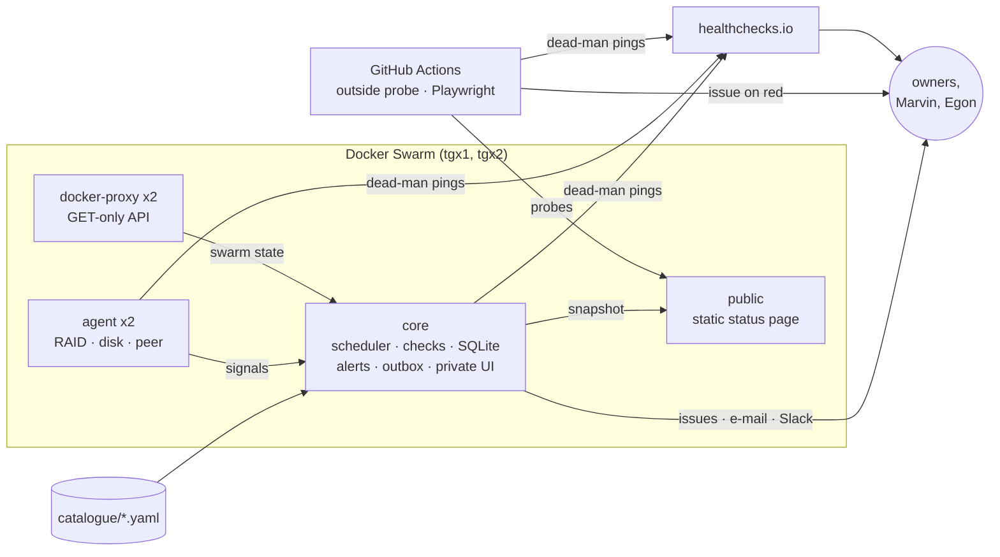

# tgx-monitor

**Status page: [status.bigcat-bioinformatics.org](https://status.bigcat-bioinformatics.org/)** ·
private detail: `monitor.bigcat-bioinformatics.org` (login)

Monitoring and alerting for the web estate of the Department of Translational Genomics
(Maastricht University): about fifty public hostnames on the two-node Docker Swarm
(tgx1/tgx2), ten Virtuoso SPARQL endpoints with weekly or monthly reloads, Flask, Shiny
and Django apps, BridgeDb, scheduled jobs and backups, and the external sites and
GitHub Actions pipelines that feed them.

## Why

The cluster had presence checks only, and they were mostly noise: 31 checks failed
permanently and flooded Slack with thousands of messages a day, while every mail
notification failed. Meanwhile the failures that mattered were silent:

- BridgeDb 2.1.8 changed its wire format, and AOP-Wiki RDF mapped 0 of 3,133 genes;
- an empty AOP-Wiki store went unnoticed for two days behind a green `200`;
- molAOP corpora fell months behind;
- a dashboard showed eight-week-old numbers while every run was green.

So this checks what a user would notice: that features work, that data has the right
shape and size, that a reload landed, that a backup exists and opens, that a cron job
ran. A down target must say *why* it is red, and must reach the person who owns it.

## What it is not

It is not a metrics stack. There is no Prometheus and no time-series database: one
SQLite file holds results, baselines and incidents. It does not fix anything and never
writes to a monitored service: every check is a read (GET/HEAD, read-only SPARQL, a
GET-only Docker API proxy). And it is not a replacement for reading the cluster
documentation in `/mnt/gluster/documentation/`, which stays authoritative.

## How it works



1. **Checks are YAML.** `catalogue/targets/<target>.yaml` holds one target (a service,
   endpoint, job or backup), its owners, what it depends on, and its checks. Each check
   names a *kind* (`http`, `sparql`, `tls`, `dns`, `roundtrip`, `job_run`, `file_age`,
   `swarm`, `host`, `gha`, ...) that observes, and a list of assertions that judge.
2. **Core runs them** on their own cadence, through public DNS and pinned to each node
   IP where it matters, and stores every result with the exact request and what came
   back. The per-check page shows why something is red.
3. **Alerts go to the owner.** Three failures in a row (two passes to recover) open one
   incident per target. Children of a failing dependency stay quiet. Maintenance
   windows record but do not send. A GitHub issue mentions the owners; e-mail and Slack
   follow the severity table in [docs/DESIGN.md](docs/DESIGN.md#5-alert-policy).
4. **The monitor is watched from outside.** Agents on both nodes, healthchecks.io
   dead-man switches and a GitHub Actions probe keep alerting when core, its node or
   the whole edge is gone.

## Adding a check

Add or edit a file under `catalogue/targets/`. The smallest useful check:

```yaml
id: qaop
name: qAOP
group: VHP4Safety tools
class: service
criticality: medium
owners: [marvinm2]
public_summary: Quantitative AOP model predictions.
checks:
  - id: qaop-health
    kind: http
    every: 5m
    via: [public, tgx1, tgx2]
    describe: The API reports healthy, with its data and models loaded.
    request: {url: "https://qaop.vhp4safety.nl/api/health", parse_json: true}
    assert:
      - {that: status, eq: 200}
      - {that: json.status, eq: healthy}
      - {that: latency_ms, lt: 3000}
```

Then:

```bash
tgx-monitor doctor                       # schema, owners, dependencies, leaks: no network
tgx-monitor check --once --only qaop -v  # run it live once and see each assertion
```

Open a pull request; CI runs `doctor`, the offline tests and the leak scans. The
catalogue is **public**: no e-mail addresses, host paths or IP addresses other than the
two node addresses. Owners are GitHub handles from `catalogue/owners.yaml`; their
e-mail addresses live in a Docker secret. The assertion grammar is documented at the top
of [`src/tgx_monitor/assertions.py`](src/tgx_monitor/assertions.py) and each kind's
request keys at the top of its module in [`src/tgx_monitor/kinds/`](src/tgx_monitor/kinds/).

Pages that only a browser can judge go in [`catalogue/browser.yaml`](catalogue/browser.yaml);
they are rendered in GitHub Actions, never on the cluster.

## Development

```bash
make install    # .venv with the hashed lock, the package and the dev tools
make check      # doctor, ruff, pytest
make offline    # the test suite with no network and no secrets
make serve-dev  # core against ./data, sending nothing
```

Tests run offline from recorded fixtures (`TGXMON_HTTP_MODE=replay`); tests marked
`live` hit the network and are deselected by default.

## Documents

- [docs/DESIGN.md](docs/DESIGN.md): architecture, check kinds, alert policy, storage, security
- [DEPLOY.md](DEPLOY.md): first deploy on the swarm, secrets, shadow mode, enabling alerts, rollback
- [RUNBOOK.md](RUNBOOK.md): what each alert means and what to do; silences, drills, owners
- Cluster documentation: `services/tgx-monitor.md` in `/mnt/gluster/documentation/`

## Licence and citation

MIT, © 2026 Department of Translational Genomics, Maastricht University. See
[LICENSE](LICENSE) and [CITATION.cff](CITATION.cff). The page style follows
[TGX-UM/tgx-outputs](https://github.com/TGX-UM/tgx-outputs).
