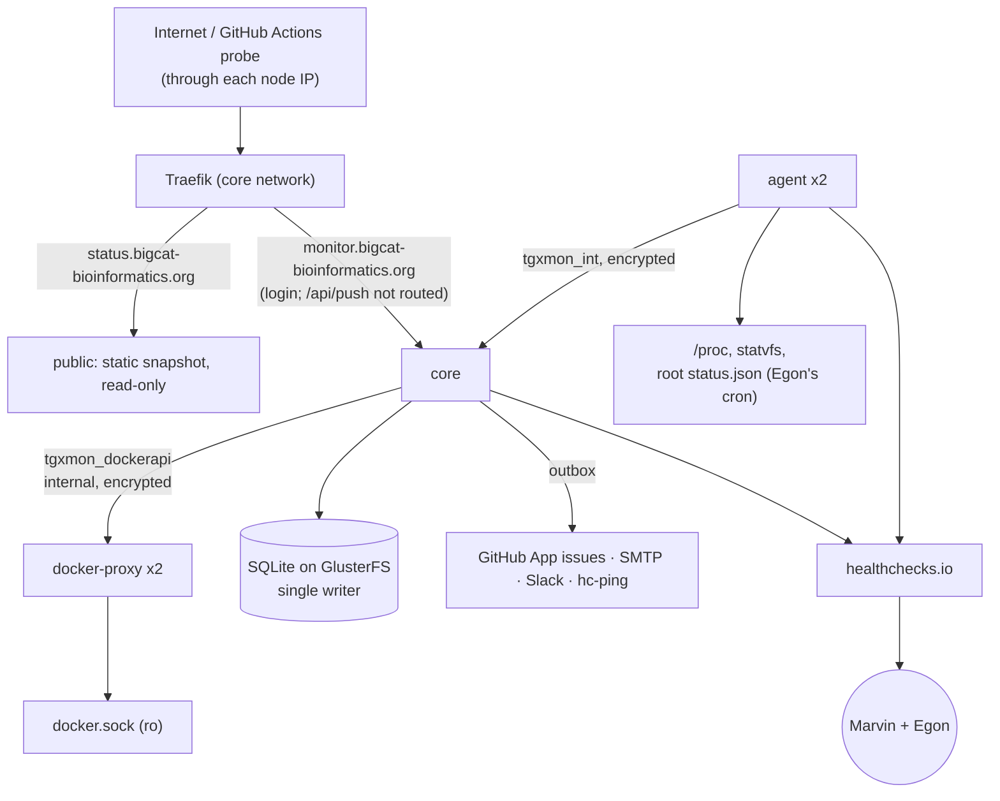

# tgx-monitor: design

This is the design the code follows, with the decisions and the reasons for them. It
started as the synthesis of three competing architectures (a custom Python service, a
Python service feeding Alertmanager, and a Gatus hybrid) and records where the build
differs from that synthesis. When this file and the code disagree, the code is right
and this file needs a pull request.

## Decision

**A custom Python service, with grafts from the other two designs.**

The alert path depends on one service, and it is crash-safe: every notification is
written to an outbox table in the same transaction as the state change that caused it,
a dispatcher retries it, and failed deliveries end as dead letters that are themselves
alerted on. The stateful and data checks (row counts against a baseline, reload
freshness, backup integrity) are native rather than bolted on, the UI is in house style
end to end, and the Docker API boundary is the tightest of the three.

Why not the others:

- **Gatus hybrid**: Gatus and a router in series, so alerting stops if either is down;
  Gatus forces WAL on its SQLite file, which must not sit on GlusterFS; its proposed
  socket-proxy settings exposed `/archive`.
- **Alertmanager**: a mass false-recovery mode (`endsAt = now + 2 h` after a restart)
  and routing kept in an immutable secret, so every routing change is a redeploy.

Grafted from the Alertmanager design: an always-firing delivery watchdog, dead-man
pings from the agents, escalation to Egon, table-driven routing tests, and a private
config for security canaries. From the Gatus design: the 2-minute hold, a reconcile
loop, opaque aliases for owners without GitHub, Playwright in Actions instead of on the
cluster, the monthly synthetic incident, and the `missing` state for backups that do
not exist.

## 1. Architecture

**Repository** `TGX-UM/tgx-monitor` (public). **Image** `ghcr.io/tgx-um/tgx-monitor`
(public package; the lowercase name is a literal, because `github.repository_owner`
expands to `TGX-UM` and Docker rejects uppercase). **Stack** `tgx-monitor`.

| Service | Image | Mode | Memory | Job |
|---|---|---|---|---|
| `core` | `tgx-monitor:sha-<7>` on `python:3.13-slim@sha256:…` | 1 replica, `stop-first`, restart `any`, `endpoint_mode: dnsrr` | 512M (256M reserved) | scheduler, checks, the single SQLite writer, alert engine, outbox and dispatcher, private UI, public snapshot writer |
| `public` | same, `tgx-monitor serve-public` | 1 replica, `start-first` | 128M | serves the static public snapshot read-only; **no secrets, no Docker access, no database** |
| `agent` | same, `tgx-monitor agent` | global, uid 10001, `cap_drop: ALL`, read-only root | 128M | per-node host signals, peer heartbeat, its own healthchecks.io pings |
| `docker-proxy` | `wollomatic/socket-proxy:1.13.2@sha256:…` | global, `cap_drop: ALL` | 64M | GET-only Docker API with an anchored allowlist |



**Libraries** (pinned with hashes in `requirements.lock`, each at least 14 days old when
pinned): httpx 0.28.1, Starlette 0.50.0, uvicorn 0.38.0, Jinja2 3.1.6, pydantic 2.12.5,
PyYAML 6.0.3, dnspython 2.8.0, websockets 15.0.1, aiosmtplib 5.0.0, argon2-cffi 25.1.0,
itsdangerous 2.2.0, PyJWT 2.10.1 with cryptography 50.0.2. Vega, Vega-Lite and
vega-embed are vendored from tgx-outputs with their SRI hashes.

*Changed in the build:* the scheduler is a plain asyncio loop rather than APScheduler
(fewer moving parts; per-probe due times with deterministic jitter), and the store is
one connection behind one lock rather than a writer thread with a queue. The ported
tgx-outputs guards (`no_silent_zero`, `monotonic`, `volume_drop`, freshness) became
assertion operators (`gte`, `monotonic`, `max_drop_pct`, `max_age`) so every kind
gets them.

**Off the cluster:** healthchecks.io (Hobbyist plan, 10 of 20 checks; ask for the
non-profit tier), the GitHub Actions workflows `probe.yml` and `browser.yml`, and the
GitHub App `tgx-monitor[bot]`.

## 2. Repository layout

```
src/tgx_monitor/
  model.py        Result, Observation, Call, Outcome; status ok|failed|unknown|skipped|blocked
  http.py         the one HTTP client: never raises, records the redirect chain, per-node pinning
                  (IP in the URL, real name in Host and TLS SNI), 429 = unknown, live/record/replay
  assertions.py   the assertion grammar shared by every kind
  catalogue.py    YAML + pydantic schema; validate() returns every problem; config sha; leak rules
  scheduler.py    the run loop; global concurrency 20, per host 2
  store.py        SQLite: TRUNCATE journal, one writer, rollups, retention, online backup
  kinds/          @register plugins: web, sparql, net (tls, dns), data, infra, pipeline
  alerts/         engine (state machine), router, windows (RRULE), outbox, dispatcher,
                  reconcile, digests, channels/{github,smtp,slack,hc}
  redact.py       strips Env/Args/Secrets/Configs and secret-shaped text at ingest
  docker.py       client for the GET-only proxy; ALLOWED_PATHS is the proxy's allowlist
  agent.py        the per-node agent and the client core uses to read it
  snapshot.py     writes the public snapshot and status.json atomically
  backup.py       backup / restore-verify
  web/            Starlette app (autoescape), auth, public server, templates, static assets
  cli.py          doctor, check --once, run, serve-public, agent, test-alert, backup, ...
catalogue/        targets/*.yaml, owners.yaml, maintenance.yaml, known_issues.yaml,
                  queries/*.rq, browser.yaml
scripts/          outside_probe.py (stdlib only), browser_checks.py (Playwright)
host/             tgx-monitor-status.sh: root cron for Egon to review and install
stack.yml  Dockerfile  DEPLOY.md  RUNBOOK.md  .github/workflows/{ci,docker,probe,browser}.yml
```

## 3. The check catalogue

One YAML file per target, written in **public-safe fields only**: no e-mail addresses,
no host paths, no IP addresses other than the two node aliases and public resolvers.
Bind mounts are named by alias (`/mounts/<alias>` in core); the host paths appear in
`stack.yml` only.

**Target:** `id`, `name`, `group`, `class` (service | data | cron | backup | infra |
security | pipeline), `criticality` (high | medium | low | muted), `owners`,
`depends_on`, `maintenance`, `public`, `public_summary`, `links`, `notes`.

**Check:** `id`, `kind`, `every`, `via` (public, tgx1, tgx2, core, agent:tgx1,
agent:tgx2; one probe per vantage point), `request` (kind-specific), `assert`,
`severity` (overrides criticality), `alert_after`, `retry` (sparse checks: one quick
retry), `timeout`, `enabled`, `public`, `inv_ids` (the inventory checks it covers).

**Assertions** are one grammar for every kind: a kind *observes* a flat dict of values,
assertions *judge* it by dotted path.

```yaml
- id: aopwiki-entity-counts
  kind: sparql
  every: 1h
  request:
    endpoint: "https://aopwiki.rdf.bigcat-bioinformatics.org/sparql"
    file: q/aop-entity-counts.rq
    pivot: {key: t, value: n}
  assert:
    - {that: by.KeyEvent, gte: 1580}                       # a floor
    - {that: by.KeyEvent, max_drop_pct: 2, window: 7d}     # vs the median of the last week
    - {that: truncated, eq: false}                         # not cut off at ResultSetMaxRows
- id: aopwiki-version-fresh
  kind: sparql
  assert:
    - {that: first.created, max_age: {warn: 8d, crit: 15d}}
```

Operators: `eq ne gt gte lt lte`, `in not_in`, `matches not_matches contains
not_contains`, `len_eq len_gte len_lte`, `exists absent`, `max_age {warn, crit}`,
`max_drop_pct` (with `window`), `monotonic`, `eq_path`, `within_pct_of_path`. Optional
on any: `warn: true` (amber, never fails) and `label`. A missing path fails with
"missing". Numbers in the catalogue compare numerically; a string in the catalogue
means a string comparison (versions such as `2026.11.07`).

**Importing the 566 inventoried checks** (`tgx-monitor import-inventory inv.json`):

1. Reconcile duplicates first: `_import/merge.yaml` maps each duplicate inventory target
   to one canonical id and owner set (jobs, pipelines and backups that several slices
   found; ToxTempAssistant split into `toxtempassistant` on VHP-1, the live app, and
   `toxtempass-swarm`, low until DNS moves).
2. Generate stubs: one per inventory check with `kind: todo`, its `inv_ids`, a suggested
   kind and the extracted URLs and queries. The prose stays in the private working copy.
3. Structure them by hand, per slice, in pull requests. `doctor` refuses any enabled
   `todo` check.
4. `test_inventory_accounted_for`: every inventory id appears in some `inv_ids` or in
   `_import/dropped.yaml` with a reason.
5. `check --once` must pass for at least 95% of the 525 checks verified live; each of the
   rest becomes a passing check or a `known_issues.yaml` entry with owner and expiry.

**`doctor` enforces:** unique ids and known kinds; every owner resolves; an acyclic
dependency graph; parseable durations, windows and assertions; no enabled `todo`; a
`public_summary` on every public target; no e-mail, stray IP or host path anywhere in
the catalogue. CI repeats the leak rules with a plain grep that does not depend on the
code it guards.

## 4. Check kinds

Each kind, what it asserts, and the incident or finding it would have caught.

- **http**: status, content markers, the full redirect chain and final URL, through
  public DNS and each node IP. (strato1 default-vhost 404s; moved services still
  answering 200; parking redirects.)
- **tls**: chain, SAN, expiry and issuer ≠ Traefik default, on **both** nodes.
  (`www.nsdra.org`, `www.psnpbind.org` and the ToxTemp swarm route serving the
  self-signed default.)
- **dns**: A = tgx1 (with an allowlist for VHP-1 and external hosts), NS sets, wildcard
  probes, dangling records. (ToxTempAssistant on VHP-1; dangling `doi.` and
  `aopwiki.api.`; the GitHub Pages wildcard that breaks ACME for new names.)
- **sparql**: ASK, row floors, baselines, truncation at `ResultSetMaxRows`. (The
  2026-09-02 empty store, missed for two days behind 200 + "Default Data".)
- **invariant**: two queries must agree. (Virtuoso's mislabelled `GROUP BY ?graph` and
  OPTIONAL counts folded across graphs.)
- **compare**: freshness against upstream with a relation and a grace period. (A reload
  that did not land; a WikiPathways release missing `rdf-gpml.zip`; a standby not
  holding the previous release; eight-week-old numbers under today's date.)
- **roundtrip**: ordered steps with captured values and known answers. (BridgeDb
  answering JSON instead of TSV; the unioned batch results; the ChEBI IRI regression;
  the empty service description.)
- **shiny**: `__sockjs__/info` says `websocket: true`, then a session opens. (200 with
  dead sessions.)
- **browser_artifact**: reads the JSON of the 6-hourly Playwright run in `browser.yml`;
  Chromium stays off the cluster. (JS apps that render blank.)
- **job_run**: arms at each `swarm.cronjob.schedule` + 2 min, records task state, exit
  code and log markers in `job_runs`, checks ordering (switch after reload); jobs also
  push to `/api/push/<job>` when they finish. 0/0 and 0/1 between runs are normal.
  (Missed runs hidden by the 5-task history; a switch without a successful reload.)
- **file_age / sqlite_backup / restore_marker**: newest file's age, size band, `gzip -t`
  or `integrity_check` on a scratch copy, off-disk copy fresh, restore-verify marker
  fresh; `missing` when no backup exists, not `stale`. (The HiDrive copy last written
  2026-05-12; five databases with no backup at all; dumps on the same volume as the
  data.)
- **swarm**: replicas, crash loops, restart policies, placement pins, local-only images
  per node against the monthly prune. (`xploreaop`, `robot`, `biodatafuse` cannot fail
  over.)
- **host**: from the agents: mdstat, statvfs, meminfo, boot time, peer ports
  2377/7946/24007, the HiDrive listing; from Egon's root status file: Gluster heal and
  split-brain, `mdadm`, `smartctl -H`, inodes, NTP, reboot-required. (TGX1 `md1`
  degraded; the 2026-10-22 and 2026-11-02 freezes.)
- **gha**: last conclusion and age, workflow `state` (`disabled_inactivity`), with ETags.
  (Pipelines feeding the services stopping silently.)
- **registry**: manifest HEAD with a dedicated classic PAT (`read:packages`), the token's
  expiry, and the image present on both nodes. *Correction:* GHCR rejects GitHub App
  tokens, and the Docker API's `/distribution` does not use credentials stored in the
  daemon; the swarm's stored auth cannot be read, so "image present on both nodes"
  covers the failure that matters. (oppbk failing on reschedule after its credential
  expired.)
- **digest_drift**: the running image changes while the tag stays the same.
  Information only. (`:latest` services pulling new code.)
- **security**: expected 401/403/404 and the absence of markers ("Virtuoso Conductor",
  "Werkzeug Debugger"); GET or HEAD only, bodies never kept. (Admin pages and debug
  servers that must stay closed.)
- **docs_drift**: `service-registry.md` and the `tgx.service.owner` labels against the
  live services and `owners.yaml`. Weekly, never pages.
- **self**: scheduler tick, outbox age, a vantage check (1.1.1.1, api.github.com), and
  token and App-key expiry (warns 30 days ahead).

## 5. Alert policy

**States per check:** `UNKNOWN → OK ⇄ PENDING → FAILING → OK`, plus `FLAPPING` (more
than 6 transitions in 2 h: one notice, then quiet), `BLOCKED` (an ancestor is failing),
`MAINTENANCE`, `SILENCED` (reason, expiry, who) and `KNOWN_ISSUE` (expiry).

- **Thresholds:** 3 consecutive failures for checks every 15 min or more often; daily
  and weekly checks retry once after 10 min. Recovery needs 2 passes. A 429 or a
  client-side timeout on a slow but answering endpoint is `unknown`, never a failure.
- **Incidents:** one per root target; its issue lists every failing check of the target.
- **A 2-minute hold** before notifying, so a parent's alert arrives first.
- **A reconcile loop** every 5 minutes closes incidents whose checks are healthy and
  flags open `alert` issues that have no incident.

**Dependencies** form a DAG: `edge-tgx1` → Traefik → every routed host; each node → the
services on it; upstreams (AOP-Wiki SPARQL, WikiPathways SPARQL, Wikidata, GitHub raw,
data.wikipathways.org, aopwiki.org) → their consumers. A child of a failing ancestor is
BLOCKED: listed in the parent's incident, silent itself, with one cycle of grace after
the parent recovers. **Vantage rule:** if more than 40% of unrelated targets fail at once
and core's own vantage check fails too, only `monitor-vantage-degraded` is sent.

**Maintenance windows** (`maintenance.yaml`, RRULE, UTC): AOP-Wiki reload Sundays
05:50–07:30; WikiPathways reload on the 12th 01:50–03:30 and switch 03:50–05:00; the
daily dashboard store build; the weekly molAOP corpus apply; the monthly prune.
Results are recorded during a window and nothing is sent; **a check still failing when
the window closes alerts at once**. Freshness checks that expect a new version run
15 minutes after the window, so a reload that did not land is caught.

**Severity × channel** (high = critical, medium = warning, low = info, muted = recorded):

| | GitHub issue | E-mail | Slack `#monitoring_alerts` |
|---|---|---|---|
| critical | open; comment every 24 h; close on recovery with the duration | at once to owners and Marvin; Egon in cc for infra, backup and security; recovery mail | open, reminder after 24 h, recovery |
| warning | open and close | daily digest at 08:00 Europe/Amsterdam | open and recovery |
| info | none | weekly digest | daily one-line summary |

- **Escalation:** a critical incident open and unacknowledged after 2 h gets an
  escalation mail and an `@egonw` mention.
- **Storm brake:** more than 8 sends per channel per minute collapse into one summary;
  Slack is capped at 20 messages an hour.

**Routing data.** `owners.yaml` is public and is the routing authority (not the
`tgx.service.owner` labels): GitHub handles, or opaque aliases (`ext-01`, ...) for
owners without one; `fallback: [marvinm2]`; `admins: [marvinm2, egonw]`; `notify: false`
until the owner has agreed to be alerted. The `tgxmon_contacts` secret maps handles and
aliases to e-mail addresses. Routing is tested table-driven: (target, class, severity,
state) in, the exact `{channel: recipients}` out.

**Channels.**

- **GitHub issues** come from the App `tgx-monitor[bot]`. *Correction:* issues opened
  with Marvin's own token would not notify Marvin. Title `[<target>] <check> failing`;
  labels `alert`, `sev:*`, `target:*`; the body carries `public_summary`, the mentions, a
  link to the private page and `<!-- tgxmon:incident=<key> -->`.
- **E-mail** via aiosmtplib from a Strato mailbox (`monitor@vhp4safety.nl`), so SPF and
  DMARC align; a dedicated Gmail account with an app password is the fallback.
- **Slack** through Egon's incoming webhook, one Block Kit line per event; live only
  after Icinga's Slack output is muted.
- **Outbox:** exponential backoff, the provider's reply stored (201, 250, 200), dead
  letters in the private UI; a channel that keeps failing raises a `self` alert on the
  other two.

**Public versus private.** Public issues and the public page carry only
`public_summary`: never raw responses, IP addresses, paths or e-mail addresses.
Security checks that name a live hole come from the private `tgxmon_private_checks`
secret and alert by e-mail and Slack only; once fixed, they move into the public
catalogue as regression checks. This is the one exception to "issues for everything",
made so the public repository does not advertise open holes.

**Test alert:** `tgx-monitor test-alert --channel all --to <handles> --who <handle>`
opens an issue labelled `test`, sends a `[TEST]` mail and posts a Slack line, and
resolves itself after 5 minutes.

## 6. UI

**Public, `status.bigcat-bioinformatics.org`:** a static snapshot rebuilt every 60 s by core
and served by `public`. Service groups with their state in words and glyphs and 90-day
bars; data-release lines ("AOP-Wiki RDF: release 2026-11-08, loaded Sun 06:12 UTC");
open incidents (public summary only); upcoming windows; per target, what is checked;
a "data as of" banner so the page stays truthful during a core outage; `/status.json`
(`generated_at`, `last_cycle_at`, `outbox_oldest_age_s`) for the watchdogs; a Traefik
rate limit.

**Private, `monitor.bigcat-bioinformatics.org`:** deny by default. Nodes, RAID, disk,
Gluster; swarm, local images, digest drift; backups; the cron timeline from `job_runs`;
pipelines; silences, known issues, incidents, the outbox log, the catalogue with its
sha, the test-alert form.

**Per-check page `/check/<id>`** (after tgx-outputs' source pages): the definition and
catalogue sha, a copyable `curl` with secrets redacted, each assertion with expected and
found, failing since, the dependency path or BLOCKED reason, window and silence state,
the incident's delivery log, a Vega history chart, and the last failing evidence as
escaped text (ANSI and control characters stripped, 64 KB cap); raw bodies only as
`text/plain` with `nosniff`.

**Auth:** per-user local accounts (username = GitHub handle, argon2 hashes in
`tgxmon_users`, roles from `owners.yaml`), so every silence and acknowledgement has a
name. Signed cookie (Secure, HttpOnly, SameSite=Lax, 12 h), CSRF on every POST, a
Traefik rate limit on `/login`. GitHub OAuth later, when owners want their own logins.

**House style** (tgx-outputs `extra.css` tokens): navy `#001c3d`, blue `#00a2db`,
orange `#e84e10`; status fresh `#0076a8`, amber `#b07d1e`, red `#c2410c`; Open Sans,
TGX and UM logos, slate dark mode, `:focus-visible` rings, `prefers-reduced-motion`,
`role="img"` on charts, muted text at 4.5:1 or better. **Strict CSP:**
`default-src 'self'`, no inline script, chart specs in `application/json` blocks.

## 7. Storage, retention, backup and restore

**Database:** `/mnt/gluster/docker/tgx-monitor/data/monitor.db`. GlusterFS is a FUSE
filesystem, so: `journal_mode=TRUNCATE`, never WAL (WAL needs shared memory that network
filesystems do not reliably provide, and the corruption shows weeks later);
`synchronous=FULL`; exactly one writing process, enforced by one replica and
`stop-first` updates.

| Data | Kept |
|---|---|
| raw results (~30k a day) | 35 days |
| evidence (redacted, 64 KB cap; on failure) | 90 days |
| raw metrics | 35 days |
| hourly rollups | 400 days |
| daily rollups, daily metric values (long baselines), `job_runs`, incidents, audit | indefinitely |

Rollups and deletes run nightly, then `incremental_vacuum`. Expected size under 500 MB.

**Backup chain:**

1. Nightly online backup (`sqlite3` backup API) to `data/backups/monitor-<date>.db` with
   a manifest (row counts, sha256, `integrity_check`); 14 kept. The CLI
   `tgx-monitor backup` opens the live file read-only, so a manual backup is never a
   second writer.
2. A root job in `TGX-UM/cronjobs` copies the newest to `/mnt/hidrive/docker/tgx-monitor/`
   (14 daily, 8 weekly) and pings healthchecks.
3. A weekly job runs `tgx-monitor restore-verify` on the HiDrive copy: integrity, sha256
   and row counts against the manifest, then a `.verified.json` marker that the
   `restore_marker` check reads; it pings healthchecks.
4. Core pushes the public daily rollups as JSONL to the orphan `history` branch (an
   off-site copy of the uptime history), next to `browser/latest.json`.
5. The monitor checks its own backups with `file_age`, `sqlite_backup` and
   `restore_marker`.

**Restore:** scale core to 0, copy the backup in, scale to 1, run `restore-verify`. Open
incidents are adopted from the `tgxmon:incident` markers in open issues, so no issue is
orphaned or duplicated. Losing the database loses history only: checks, owners and
windows are in git, baselines rebuild from the rollups.

**If SQLite on Gluster fails the soak** (72 h, 20 `stop-first` updates, ending in
`integrity_check = ok`), the fallback is `postgres:17` on Gluster, also `stop-first`.

## 8. Swarm deployment

**Networks:** `core` (external) for core and public; `tgxmon_int` (overlay, encrypted)
for core and the agents; `tgxmon_dockerapi` (overlay, `internal: true`, encrypted) for
core and the proxy only; the agent never touches the Docker API. The encrypted overlays
need IPsec ESP between the two nodes, which the host firewall does not list today;
DEPLOY.md step 6 tests it.

**Placement:** no node pins, no host ports. Core reaches each node's proxy through
`tasks.docker-proxy` and identifies the node from `/info`. Core runs with
`endpoint_mode: dnsrr`, so its service name resolves to the task's own address, which
is what the proxy's `-allowfrom=tgx-monitor_core` compares the caller with.

**docker-proxy:** `-allowGET` with the allowlist in `tgx_monitor.docker.ALLOWED_PATHS`
(`/v1.44`–`/v1.53`: `info nodes services tasks events images/json containers/json
tasks/<id>/logs`), anchored by the proxy itself; `-allowfrom=tgx-monitor_core`; socket
mounted read-only; user `65534` with the docker group; watchdog on. The contract test
and a live check assert 403 for `/containers/<id>/json`, `/archive`, `/export`,
`/secrets`, `/configs`, `/images/<x>/get` and any POST. *Correction:* the `/tasks` and
`/services` list responses already contain `ContainerSpec.Env` (passwords included), so
`redact.py` strips Env, Args, Secrets and Configs at ingest, before anything is stored.

**Binds:** core: `data/` and `public/` and `agent-hb/` (rw); the cluster documentation,
the Traefik dynamic directory, each backup directory and HiDrive (ro, under
`/mounts/<alias>`). public: `public/` (ro). agent: `/etc/os-release` (statvfs of /), the Gluster `root-status/` directory,
`/mnt/gluster-brick` (statvfs only) and `/mnt/hidrive` (ro), `agent-hb/` (rw); never `/`
or `/var/run`.

**Traefik:** core ``Host(`monitor.bigcat-bioinformatics.org`) && !PathPrefix(`/api/push`)``
plus a rate-limited `/login` router; public ``Host(`status.bigcat-bioinformatics.org`)``;
`websecure`, `letsencrypt`, `traefik.docker.network=core`. The routers stay
`traefik.enable=false` until the A records exist, because an HTTP-01 challenge for a
name that does not resolve here loops. Cron jobs push to `tgx-monitor_core:8000` over
`core`; the app rejects pushes that carry forwarding headers.

**Healthchecks:** core `/livez` reports only the scheduler's tick age, never a target's
state, so a down target can never restart-loop the monitor (`start_period` 60 s).

**Secrets** (read as files under `/run/secrets`, no shim; rotate by creating `_v2`):
`tgxmon_gh_app_key`, `tgxmon_gh_token`, `tgxmon_ghcr_read_pat`, `tgxmon_smtp`,
`tgxmon_contacts`, `tgxmon_users`, `tgxmon_session_key`, `tgxmon_push_tokens`,
`tgxmon_hc_urls`, `tgxmon_private_checks` (Marvin); `tgxmon_slack_webhook` (Egon). A
missing secret makes the check or channel that needs it `unknown`; it never crashes the
process or falls back to something weaker.

**Release:** CI runs ruff, `doctor`, the offline tests, gitleaks and the catalogue leak
grep, then builds and pushes `sha-<7>` and `latest`. Every action is pinned to a commit
SHA. Deploys are by hand onto a sha tag; rollback is the previous sha.

## 9. Watchdog

Ten healthchecks.io checks, each e-mailing Marvin and Egon:

| Check | Pinged by | Period / grace |
|---|---|---|
| `core-cycle` | core, only after a complete scheduler cycle | 5 min / 10 min |
| `delivery-watchdog` | an always-firing synthetic notification through the **real** outbox and dispatcher | 5 min / 10 min |
| `agent-tgx1`, `agent-tgx2` | each agent; `/fail` with the reason when core's or the peer's heartbeat is older than 5 min | 1 min / 5 min |
| `gha-probe` | `probe.yml` | 20 min / 6 h |
| `root-status-tgx1`, `root-status-tgx2` | Egon's root cron | 5 min / 15 min |
| `hidrive-copy`, `restore-verify`, `monitor-backup` | the cron jobs and core | daily or weekly / 6 h |

**`probe.yml`** (`7,27,47 * * * *`) runs `scripts/outside_probe.py` (standard library
only) from GitHub's runners: through each node IP with the real name as SNI, it checks
that `status.json` is under 15 minutes old and probes about fifteen sentinel URLs; it
checks the A records against tgx1 over DNS-over-HTTPS to 1.1.1.1. On a cluster-level
problem it keeps one `outside-probe` issue open (mentioning `@marvinm2 @egonw`, comments
at most hourly, closes on green) using only `GITHUB_TOKEN`, and pings `gha-probe` with
`/fail`. **Keepalive:** core re-enables `probe.yml` and `browser.yml` through the API
daily, because GitHub disables schedules after 60 days without repository activity.

A two-manager freeze cannot reschedule core; the surviving agent's `/fail`, the outside
probe and the dead-man checks carry the alert then.

## 10. Milestones

| | Content | Exit criterion |
|---|---|---|
| **M0** | repo, App, PAT, healthchecks account; Egon's steps; hairpin test; SQLite soak | the A records resolve; `docker secret ls` shows all secrets; `status.json` fresh on both nodes; a container reaches both public IPs on 443 (else per-node checks move to the agent probing the *other* node); 72 h soak ends with `integrity_check = ok`; Icinga's Slack output muted |
| **M1** | http, tls, dns, sparql; scheduler; store; replay tests; CI to GHCR; core and public in shadow mode | 50 checks for 48 h; `core-cycle` green 24 h; `make offline` passes; nothing sent |
| **M2** | import, merges, owners, dependencies, windows, compare, roundtrip, shiny | all 566 accounted for; `doctor` clean; 95% of verified checks pass; the rest are known issues with owner and expiry |
| **M3** | engine, outbox, three channels, routing tests, escalation, reconcile, healthchecks, probe | CI scenarios pass; two weeks of dry run with under 5 would-be notifications a day; critical alerts go live |
| **M4** | proxy, agent, root status, job_run and push, backups, registry, gha, digest drift, security, docs drift | every cron job has a recorded run; `md1` shows its real state; live proxy refusals pass; every stateful store `ok` or `missing` |
| **M5** | public and private UI, auth, rollups, charts | the leak test (a planted canary string, `/mnt/`, an e-mail address) finds nothing in HTML, issues or Slack payloads; CSP present; axe shows no serious issue |
| **M6** | restore drill, OAuth, docs, owner onboarding, Icinga retired | drill recorded; all healthchecks green 7 days; each owner has answered an onboarding issue |

## 11. Verification

1. **CI scenarios** (mailpit and a GitHub/Slack stub, fake clock): a leaf failure gives
   one issue with the right mentions and recipients; an `edge-tgx1` failure gives one
   parent issue and silent children; a failure inside a window alerts when it closes;
   recovery closes the issue; a restart creates no duplicates; a Slack 500 retries, then
   dead-letters and alerts on the other channels; a restored database adopts the open
   issues.
2. **Live broken check:** `test-incident --break` on `monitor-selftest` (critical, owners
   `marvinm2` and one consenting tool owner) gives, within 3 cycles and the hold, a bot
   issue mentioning both, the mails and a Slack line with replies 201/250/200; `--fix`
   closes it with recovery messages. Repeated as class `infra` for the Egon cc and left
   open past 2 h for escalation.
3. **Watchdog drill:** core scaled to 0 for 20 minutes trips `core-cycle`,
   `delivery-watchdog`, both agents and the outside probe; everything recovers on
   scale-up. A paused `probe.yml` trips `gha-probe` within 6 h.
4. **Monthly synthetic incident:** the live broken check, automated; it fails loudly if a
   leg is missing.

## 12. Risks

1. **Bus factor.** Custom code that one person knows. Mitigation: well under 6k lines,
   one plugin contract, checks as YAML through pull requests, RUNBOOK.md, and outside
   watchdogs that keep alerting if core is abandoned.
2. **Alert fatigue**, the Icinga lesson. Mitigation: shadow mode, k-of-n, one incident
   per target, BLOCKED children, the vantage rule, the storm brake, digests, expiring
   known issues, and Egon mentioned only for infra, backup, security and escalation.
3. **Shared fate with the cluster.** Mitigation: the agents' `/fail` path, the delivery
   watchdog, the outside probe, and a public snapshot that survives a core outage.
4. **Leaks** through the public repository, issues or the Docker API. Mitigation: the
   private canary config, security alerts kept off public issues, the anchored proxy
   allowlist, Env stripped at ingest, autoescape and CSP, leak tests, gitleaks, and a
   security review before every push.
5. **SQLite on Gluster.** Mitigation: TRUNCATE journal, one writer, `stop-first`, the
   soak, nightly backups with an off-disk copy and a weekly restore-verify; Postgres as
   the fallback.
6. **Dependence on Egon and on SMTP deliverability.** Mitigation: one batched request;
   GitHub and Slack work before mail does; the delivery watchdog proves each channel
   daily.
